# Nusa for Linux

[](https://github.com/Seteven2729/nusa-linux/actions/workflows/ci.yml)

Notch kecil di tengah atas layar untuk desktop Linux berbasis Wayland. Terinspirasi dari [Nusa for Windows](https://rama2555.github.io/nusa/), ditulis ulang dari nol dengan Rust dan GTK4. Untuk pemakaian pribadi.

Hover notch untuk membukanya, geser kursor menjauh untuk menutupnya. Notch yang terbuka punya lima halaman, pindah dengan panah ‹ ›: Home (jam, tanggal, statistik, clipboard), Media (player), Mixer (volume per aplikasi), Download, dan Screenshots. Saat dibuka, notch langsung ke Media kalau ada lagu, ke Download kalau ada yang sedang diunduh, dan ke Home kalau tidak keduanya.

<p align="center">
  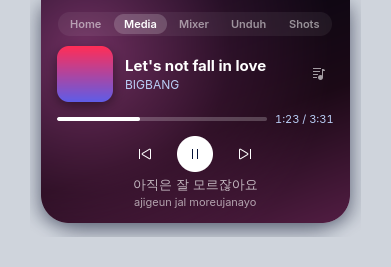
</p>

## Tampilan

<table>
  <tr>
    <td align="center">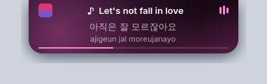<br>Tertutup saat musik diputar: lirik dan romanisasinya</td>
    <td align="center">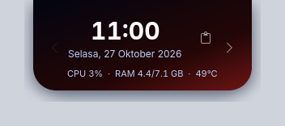<br>Idle: jam, tanggal, CPU/RAM/suhu</td>
  </tr>
  <tr>
    <td align="center" colspan="2">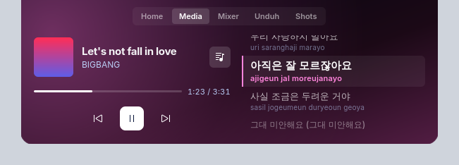<br>Panel lirik penuh. Baris yang sedang dinyanyikan menyala, klik baris lain untuk lompat.</td>
  </tr>
  <tr>
    <td align="center">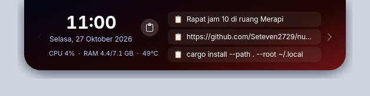<br>Clipboard, terbuka hanya setelah tombolnya diklik</td>
    <td align="center">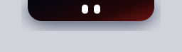<br>Maskot muncul saat kamu idle</td>
  </tr>
  <tr>
    <td align="center">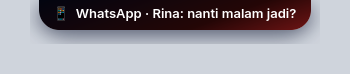<br>Notifikasi HP lewat KDE Connect</td>
    <td align="center">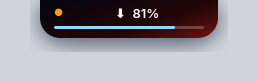<br>Progres download, titik oranye = mikrofon dipakai</td>
  </tr>
  <tr>
    <td align="center" colspan="2">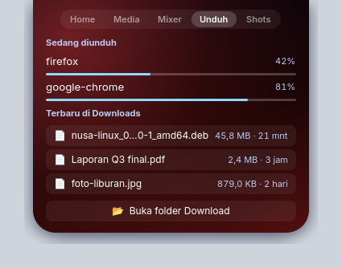<br>Halaman Download: semua download yang berjalan dan file terbaru</td>
  </tr>
  <tr>
    <td align="center">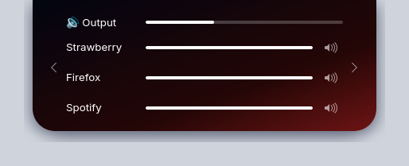<br>Mixer: volume output dan volume per aplikasi</td>
    <td align="center">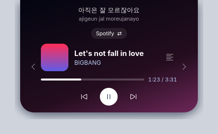<br>Ganti player yang dikontrol kalau ada lebih dari satu</td>
  </tr>
  <tr>
    <td align="center" colspan="2">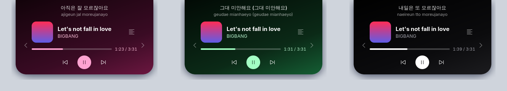<br>Tema rose, forest, dan midnight. Pilih dari menu tray, Tema.</td>
  </tr>
</table>

Warna notch ikut cover lagu saat musik diputar, dan ikut wallpaper saat idle. Semua isi di screenshot adalah data contoh.

## Fitur

- Lagu yang sedang diputar dari player MPRIS mana pun (Spotify, Strawberry, browser, mpv): cover, judul, artis, prev/play/next, seek bar
- Warna gradien notch mengikuti warna cover lagu, dan saat idle mengikuti warna wallpaper Plasma
- Lirik tersinkron dari [lrclib.net](https://lrclib.net), satu baris di bawah judul, atau panel lirik penuh (klik baris untuk lompat)
- Romanisasi lirik untuk Korea, Jepang (termasuk kanji), Mandarin (pinyin), dan Cyrillic
- Popup charger dicolok/dicabut, Wi-Fi tersambung/putus, headphone Bluetooth tersambung beserta baterainya
- Titik oranye saat mikrofon dipakai, hijau saat kamera menyala, merah saat layar sedang di-share
- Progres download (browser dan aplikasi lain yang memakai Unity LauncherEntry): bar tipis di notch, lalu popup saat selesai. Halaman Download menampilkan semua download yang berjalan dan 4 file terbaru di folder Download (klik untuk membuka).
- Notifikasi HP lewat KDE Connect, termasuk telepon masuk
- Maskot mata saat idle: muncul setelah 30 detik, tertidur setelah 3 menit, tersenyum saat kamu kembali. Kalau musik sedang jalan, maskot tersenyum dan mengangguk-angguk. Kalau di-pause, matanya mengantuk.
- Saat tidak ada lagu: jam besar, tanggal (bahasa Indonesia), dan CPU/RAM/suhu
- Tombol clipboard di tampilan idle: membuka 3 isi clipboard terakhir (klik untuk copy ulang). Panel tertutup lagi setiap notch ditutup. Tombol QR di tiap item menampilkan isinya sebagai kode QR untuk dipindai HP (maksimal 500 karakter).
- Halaman Screenshots: 5 screenshot terbaru dari `~/Pictures/Screenshots`. Seret thumbnail ke aplikasi lain, klik untuk membuka, × untuk menyembunyikan dari daftar (file tidak dihapus). Setiap screenshot baru memunculkan thumbnail sebentar di notch.
- Halaman Mixer: volume output dan slider plus tombol bisu untuk setiap aplikasi yang sedang memutar suara
- Kalau ada lebih dari satu player (misalnya Strawberry dan browser), tombol `⇄` di halaman Media memilih player yang dikontrol. Pilihan itu bertahan sampai player-nya ditutup.
- Tema warna (`nusa`, `midnight`, `rose`, `forest`, atau `custom`) dan bahasa tampilan (Indonesia atau Inggris)
- Menu tray: start with login, minimal notch (garis tipis), maskot, tema, edit settings, reload, exit
- Hidup lagi sendiri kalau crash (systemd user service)

## Gesture

Berlaku langsung di notch, tanpa perlu membukanya.

| Gesture | Aksi |
|---|---|
| Scroll atas/bawah (mouse atau dua jari) | Volume ±5% |
| Geser dua jari kiri/kanan | Lagu sebelumnya/berikutnya |
| Klik tengah | Play/pause |

## Kebutuhan

Desktop harus berjalan di Wayland dengan dukungan `wlr-layer-shell`.

| Desktop | Status |
|---|---|
| KDE Plasma (Wayland) | Semua fitur jalan |
| Hyprland, Sway, niri, COSMIC | Jalan. Tray icon butuh bar dengan system tray (mis. Waybar) |
| GNOME | Tidak didukung, GNOME tidak punya layer-shell |
| Sesi X11 | Tidak didukung |

Layanan berikut opsional. Kalau tidak ada, fiturnya diam dan sisanya tetap jalan:

- UPower untuk popup charger
- NetworkManager untuk popup Wi-Fi
- BlueZ untuk popup headphone
- `ext-idle-notify` di compositor untuk maskot
- `wpctl` (WirePlumber) untuk gesture volume, `pactl` untuk indikator mikrofon
- Klipper (bawaan KDE) untuk daftar clipboard
- KDE Connect dengan HP yang sudah di-pair untuk notifikasi HP

Font yang dipakai Inter, dengan cadangan Noto Sans.

## Install dari release

Unduh file terbaru dari halaman [Releases](https://github.com/Seteven2729/nusa-linux/releases). Tidak perlu Rust.

**Kubuntu / Ubuntu 26.04 ke atas**

```sh
sudo apt install ./nusa-linux_*_amd64.deb
nusa-linux &
```

`apt` ikut memasang GTK4 dan gtk4-layer-shell. Ubuntu 24.04 belum bisa, karena repo-nya tidak punya gtk4-layer-shell.

**Arch Linux, lewat PKGBUILD** (dikelola pacman, bersih saat uninstall)

```sh
git clone https://github.com/Seteven2729/nusa-linux.git
cd nusa-linux/packaging/aur
makepkg -si
```

`makepkg` mengunduh binary dari release, memeriksa checksum-nya, lalu memasang paket `nusa-linux-bin`. Hapus dengan `sudo pacman -R nusa-linux-bin`.

**Arch Linux, manual**

```sh
sudo pacman -S --needed gtk4 gtk4-layer-shell
tar xzf nusa-linux-*-x86_64-linux.tar.gz
install -Dm755 nusa-linux-*-x86_64-linux/nusa-linux ~/.local/bin/nusa-linux
~/.local/bin/nusa-linux &
```

Setelah itu centang `Start with login` di menu tray (lihat bawah). Untuk cek file unduhan: `sha256sum -c SHA256SUMS --ignore-missing`.

## Install dari source

### 1. Pasang Rust

```sh
curl --proto '=https' --tlsv1.2 -sSf https://sh.rustup.rs | sh
```

Atau lewat package manager distro (`rust` di Arch).

### 2. Pasang library GTK4 dan gtk4-layer-shell

```sh
# Arch / Manjaro / EndeavourOS
sudo pacman -S gtk4 gtk4-layer-shell

# Fedora
sudo dnf install gtk4-devel gtk4-layer-shell-devel

# Ubuntu 25.04+ / Debian 13+
sudo apt install libgtk-4-dev libgtk4-layer-shell-dev
```

### 3. Build dan pasang

```sh
git clone https://github.com/Seteven2729/nusa-linux.git ~/nusa-linux
cd ~/nusa-linux
cargo install --path . --root ~/.local
```

Binary terpasang di `~/.local/bin/nusa-linux`.

### 4. Jalankan

```sh
~/.local/bin/nusa-linux &
```

Untuk autostart saat login, klik ikon Nusa di system tray dan centang `Start with login`. Ikonnya berupa pil putih. Di KDE, kalau tidak terlihat, cek panah `^` di tray.

`Start with login` memasang systemd user service `nusa-linux.service`. Selain jalan otomatis saat login, service ini menyalakan Nusa lagi 2 detik setelah crash. Exit dari tray tidak dianggap crash, jadi Nusa tetap mati. Status dan log:

```sh
systemctl --user status nusa-linux.service
journalctl --user -u nusa-linux.service
```

## Setting

Semua setting ada di `~/.config/nusa/config.toml`, yang dibuat otomatis saat pertama kali jalan. Setiap baris ada penjelasannya. Buka lewat tray, `Edit settings`, lalu pilih `Reload` untuk menerapkan perubahan.

Yang bisa diatur:

- Bahasa tampilan: `language = "id"` atau `"en"`
- Fitur mana saja yang aktif: lirik, romanisasi, gesture, statistik, clipboard, mikrofon, kamera dan share layar, mixer, screenshot, notifikasi HP, download, baterai, Wi-Fi, Bluetooth
- Berapa detik idle sebelum maskot muncul dan tertidur
- Tema warna (`theme`), yang juga bisa dipilih dari menu tray, Tema, dan langsung berlaku tanpa reload. Atau gradien sendiri dengan `theme = "custom"`, dan apakah warnanya ikut cover lagu atau wallpaper. Selama `follow_cover`/`follow_wallpaper` aktif, warna cover/wallpaper menimpa tema; matikan keduanya untuk melihat warna tema terus.

Nilai yang salah atau hilang memakai default, jadi file yang rusak tidak membuat Nusa gagal jalan.

## Update setelah mengubah kode

```sh
cd ~/nusa-linux
cargo install --path . --root ~/.local
systemctl --user restart nusa-linux.service
```

Kalau tidak memakai `Start with login`, ganti baris terakhir dengan `pkill -x nusa-linux; ~/.local/bin/nusa-linux &`.

## Uninstall

```sh
systemctl --user disable --now nusa-linux.service
pkill -x nusa-linux
rm ~/.local/bin/nusa-linux ~/.config/systemd/user/nusa-linux.service
rm -r ~/.config/nusa ~/.cache/nusa
```

## File yang dipakai

| Path | Isi |
|---|---|
| `~/.config/nusa/config.toml` | Semua setting |
| `~/.config/systemd/user/nusa-linux.service` | Autostart dan restart otomatis, dipasang lewat tray |
| `~/.cache/nusa/lyrics/` | Lirik yang sudah pernah diambil, supaya langsung muncul di pemutaran berikutnya |

## Privasi

Satu-satunya data yang keluar dari komputer adalah judul, artis, dan durasi lagu yang dikirim ke lrclib.net untuk mencari lirik. Cover dari browser diunduh langsung dari URL yang diberikan player.

Isi clipboard hanya tampil setelah tombol clipboard diklik. Notifikasi HP muncul 5 detik tanpa perlu hover, jadi perhatikan saat berbagi layar.

## Troubleshooting

- **Notch tidak muncul.** Jalankan `nusa-linux` dari terminal tanpa `&` dan lihat errornya. Pastikan sesi Wayland: `echo $XDG_SESSION_TYPE` harus `wayland`.
- **Lagu tidak terdeteksi.** Cek apakah player terdaftar di MPRIS: `busctl --user list | grep mpris`.
- **Titik mikrofon tidak muncul.** Cek apakah ada stream yang aktif: `pactl list source-outputs short`. Titik hanya tampil saat notch tertutup.
- **Nusa mati terus setelah crash.** systemd berhenti mencoba kalau crash berulang dalam waktu singkat. Lihat penyebabnya di `journalctl --user -u nusa-linux.service`, lalu `systemctl --user reset-failed nusa-linux.service` dan start lagi.
- **Muncul dua notch.** Tidak seharusnya terjadi, Nusa hanya mengizinkan satu instance. Jalankan `pkill -x nusa-linux` lalu buka lagi.

## Lisensi

GPL-3.0-or-later, lihat [LICENSE](LICENSE). Romanisasi kanji memakai [kakasi](https://crates.io/crates/kakasi), yang berlisensi GPL-3, sehingga program ini juga GPL-3.

Bacaan kanji diambil dari kamus tanpa melihat konteks kalimat, jadi kadang meleset. Beberapa kata yang paling sering muncul di lirik (君, 愛して, partikel は setelah kata ganti) dikoreksi manual.

## Rilis versi baru

1. Naikkan `version` di `Cargo.toml`, commit.
2. Buat tag yang sama dan push: `git tag v0.2.0 && git push repo v0.2.0`.
3. GitHub Actions membangun `.deb`, `.tar.gz`, dan `SHA256SUMS` lalu memasangnya di halaman Releases. Tag yang tidak cocok dengan `Cargo.toml` ditolak.
4. Workflow yang sama lalu mengarahkan `packaging/aur/PKGBUILD` dan `.SRCINFO` ke release baru (versi dan checksum) dan meng-commit-nya ke `master` sebagai `github-actions[bot]`. Jalankan `git pull` sebelum commit berikutnya. Kalau perlu manual: `packaging/aur/bump.sh <versi> <sha256 tarball>`.

## Test

```sh
cargo test
```
